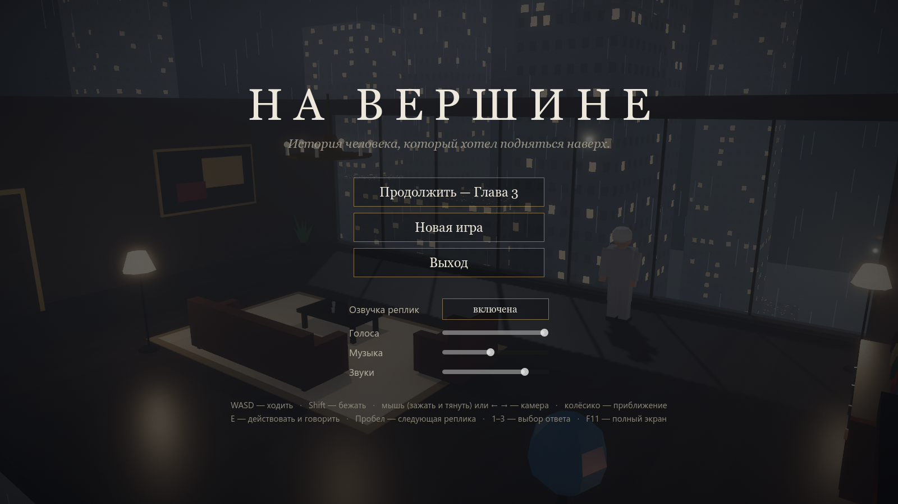
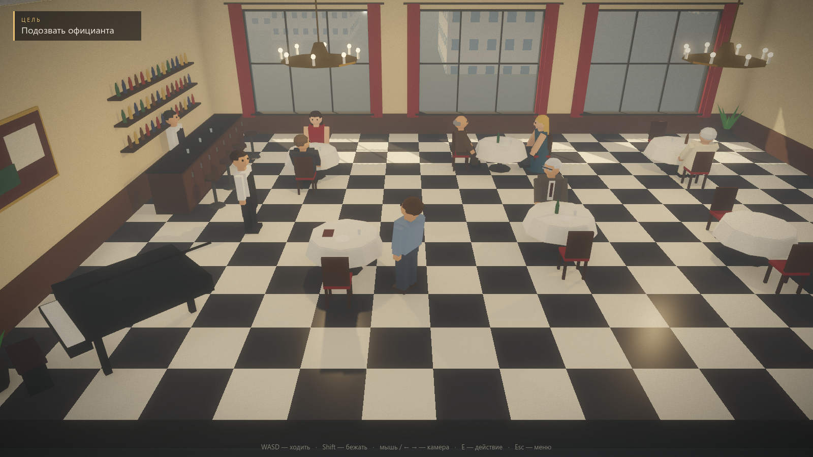
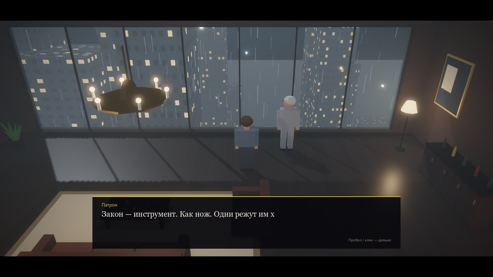
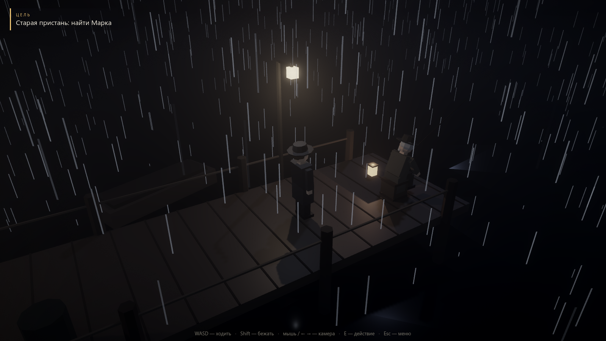
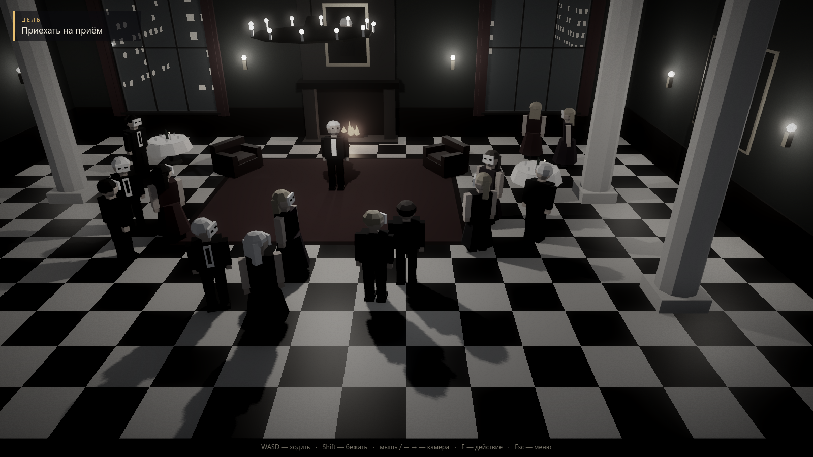

# НА ВЕРШИНЕ

> *История человека, который хотел подняться наверх.*

Короткая нуар-игра на пять глав: low-poly 3D, вид от третьего лица, дождь, молнии и полностью озвученные диалоги. Сделана на **Godot 4.7**. Вся геометрия, интерфейс и сюжет собираются кодом — ни одной готовой 3D-модели.



## О чём игра

Ты — обычный человек из среднего класса, который случайно садится за столик дорогого ресторана. Когда в зале начинается потасовка, все смотрят в тарелки — и только ты встаёшь. Богатый незнакомец, за которого ты вступился, обещает помочь «пробиться наверх». Нужны сущие пустяки: забрать конверт, подбросить папку, заставить подписать бумагу.

С каждой главой задания становятся грязнее, а мир вокруг — мрачнее: ясный день сменяется дождём, дождь — грозой, твоя квартира пустеет, краски выцветают. Вершина оказывается совсем не тем, чем казалась снизу.

В игре нет боёв и таймеров. Только ходьба, разговоры, несколько выборов и ощущение, что обратного пути нет. Прохождение занимает около часа.

| | |
|---|---|
|  |  |
| Глава 1. Ресторан «Золотой фазан» | Глава 2. Квартира Патрона |
|  |  |
| Глава 4. Старая пристань | Глава 5. Приём на вершине |

## Главы

1. **Шанс** — ясный день. Ресторан, драка, обещание.
2. **Грязная работа** — моросит дождь. Первые поручения.
3. **У всего есть цена** — ливень и молнии. Поручение за гранью.
4. **Пустой трон** — гроза, в окнах ничего не видно. Последнее задание.
5. **На вершине** — ночь после грозы. Открытый финал.

Игру можно пройти по-разному: часть ответов меняет реплики и то, как герой всё это переживает. Финал один — и он намеренно оставляет вопрос.

## Как играть

**Из исходников:** установите [Godot 4.7](https://godotengine.org/download), откройте `project.godot` и нажмите F5. На Windows можно просто запустить `run.bat` — он найдёт Godot, установленный через `winget install GodotEngine.GodotEngine`.

### Управление

| Клавиша | Действие |
|---|---|
| `W` `A` `S` `D` | ходить |
| `Shift` | бежать |
| мышь (зажать и тянуть) или `←` `→` | вращать камеру |
| колёсико | приблизить / отдалить |
| `E` | действовать, говорить, входить в двери |
| `Пробел` / клик | следующая реплика |
| `1` `2` `3` | выбор ответа |
| `Esc` | меню: громкость, озвучка, начать заново |
| `F11` | полный экран / окно |

Золотой ромб над предметом или дверью показывает, куда идти. Прогресс сохраняется в начале каждой главы.

## Как это сделано

- **Движок:** Godot 4.7, Forward+, объёмный туман, SSAO, динамический дождь на GPU-частицах, молнии как источник света.
- **Мир из кода:** 11 локаций, мебель, люди с процедурной анимацией — всё из примитивов с плоским затенением (`scripts/levels.gd`, `furn.gd`, `human.gd`, `build.gd`).
- **Сюжет** целиком в одном файле — `scripts/story.gd`; реплики и сцены пишутся последовательным кодом с `await`.
- **Озвучка:** 317 реплик (около 28 минут), у каждого персонажа свой голос. Мысли героя звучат с лёгким эхом, телефонный голос пропущен через «трубочный» фильтр, а «Мы принимаем вас» — хор из пяти голосов. Голоса — нейросетевые ([edge-tts](https://github.com/rany2/edge-tts)), генерируются скриптом прямо из текста сюжета.
- **Звук:** живые записи эффектов, музыка с плавными переходами между главами; во время реплик музыка приглушается.

### Если хотите править текст

Озвучка привязана к тексту реплик. После правки `scripts/story.gd`:

```
python -m venv tools/.venv
tools/.venv/Scripts/pip install edge-tts numpy soundfile
tools/.venv/Scripts/python tools/gen_voice.py
```

Скрипт озвучит только новые и изменённые реплики (нужен интернет). Голос персонажа меняется в таблице `CAST` в начале `tools/gen_voice.py`. Проверка результата: `tools/check_voice.py`. Затем один раз откройте проект в редакторе Godot — он подхватит новые файлы.

### Автоматические проверки

```
powershell tools/check.ps1 -GameArgs "--autoplay","--flavor"   # прогон всего сюжета без окна
powershell tools/check.ps1 -GameArgs "--reach"                  # до всех точек можно дойти
powershell tools/check.ps1 -GameArgs "--bot","--ch=1"           # бот проходит игру нажатиями клавиш
```

Запуск с нужного места: `godot --path . -- --ch=3 --stage=2`.

## Авторы и лицензии

- **Музыка:** Kevin MacLeod ([incompetech.com](https://incompetech.com)), лицензия [CC BY 4.0](https://creativecommons.org/licenses/by/4.0/).
- **Звуковые эффекты:** [BigSoundBank.com](https://bigsoundbank.com), свободная лицензия (аналог CC0).
- **Движок:** [Godot Engine](https://godotengine.org), лицензия MIT.

Полный список треков и записей — в [CREDITS.txt](CREDITS.txt).

Концепция игры — gefest160-star. Код, текст, озвучка и сборка — вместе с Claude.
